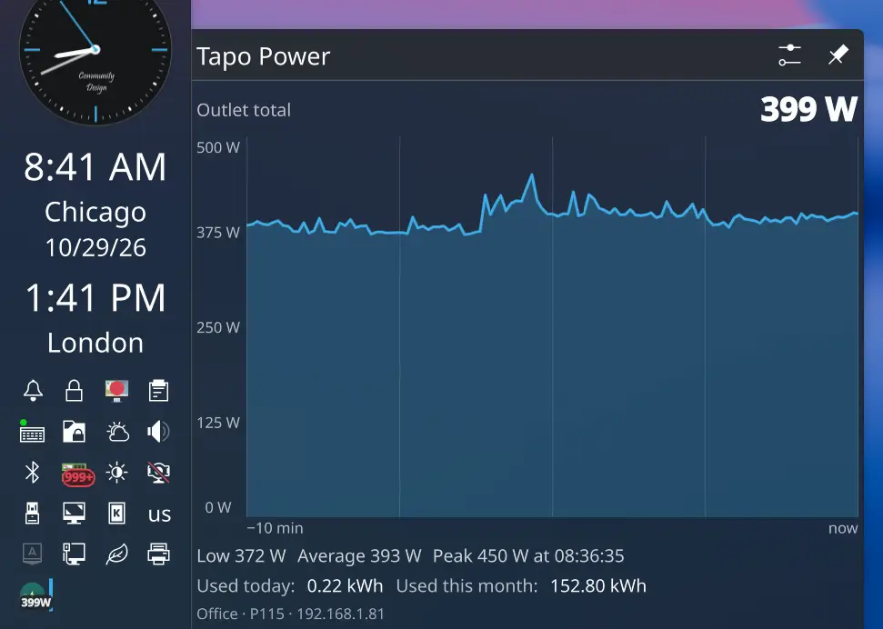

# Tapo Power

A KDE Plasma 6 panel widget that shows live power draw from a TP-Link Tapo
energy-monitoring plug (P110/P115), read directly over the local network.

- Live watts in the panel, with a tooltip showing today's usage
- Full view with a rolling graph, plus low / average / peak for the window
- Today and month energy totals from the plug
- No cloud round trip: the helper talks the plug's local KLAP protocol



> Vibe coded with [Claude](https://claude.com/claude-code) (Claude Haiku 5.5).

## Requirements

- KDE Plasma 6
- Python 3 with `python3-cryptography`
- A Tapo P110 or P115 on your LAN, added to your Tapo account
- **Third-Party Compatibility** enabled in the Tapo app (Me > Tapo Lab).
  Newer firmware refuses local logins until this is on.

## Install

```sh
./install.sh
tapo-power --setup      # stores your Tapo account email and password
```

Then add **Tapo Power** to a panel, or enable it under
System Tray Settings > Entries.

The installer is per-user and needs no sudo. It puts the helper in `~/bin`
and the applet in `~/.local/share/plasma/plasmoids`.

## Devices

Set **Plug addresses** in the widget settings, one per line. The widget shows
a card per plug in a scrolling list, with each plug's watts, a sparkline, and
today and month energy. The header totals every plug that is reporting.

The helper caches a session per address, so several plugs do not interfere.
The panel shows the total across all plugs.

The helper logs in with your Tapo account, so it can only read plugs that are
registered to that same account. Plugs on another account will fail with
"wrong Tapo email or password". Each plug must also be reachable at its LAN
address from this machine.

## Credentials

`tapo-power --setup` writes your Tapo email and password to
`~/.config/tapo-power/credentials` (mode 0600). They are sent only to the plug
on the local network, never to a cloud service.

## Files

- `tapo-power` is the helper. It prints one JSON reading per call.
- `plasmoid/io.github.jboero.tapopower/` is the Plasma applet.
- `install.sh` installs both.

## License

GPL-2.0-or-later, as declared in the applet metadata.
